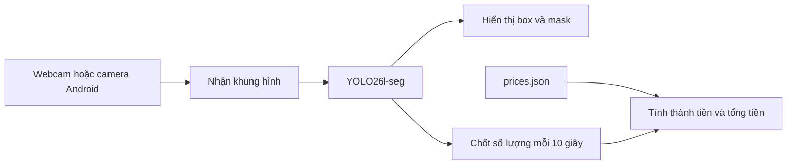

# CV_AI — Grocerystuffs Scanner

Đồ án nhận diện sản phẩm bằng **YOLO26l-seg**, sử dụng webcam máy tính hoặc camera
điện thoại Android. Chương trình hiển thị bounding box, mask của từng vật phẩm,
đếm số lượng và tính tổng tiền theo bảng giá cấu hình.

Model hiện tại có **31 lớp sản phẩm**. Dữ liệu được gán nhãn trên Ultralytics,
export thành NDJSON rồi chuẩn bị và train trên Google Colab.

## Video demo

> **[TODO VIDEO 01 — DEMO CHÍNH, 30–60 GIÂY]**
>
> **Chèn link video ngay dưới ghi chú này.** Quay cả vùng camera và bảng tính tiền:
> đặt 2–3 sản phẩm có trong model vào khung, giữ yên đến lần cập nhật 10 giây,
> rồi thêm hoặc lấy bớt một món và chờ lần cập nhật tiếp theo.
> Cần thấy rõ box/mask, tên sản phẩm, số lượng, đơn giá, thành tiền và tổng tiền.
> Đối chiếu phép tính với `cam_test/prices.json` tại thời điểm quay.

<!-- TODO VIDEO 01: thay ghi chú bên trên bằng link video demo đã quay. -->

## Chức năng hiện có

- Nhận diện nhiều sản phẩm trong cùng khung hình, hiển thị box và mask.
- Bảng số lượng, đơn giá, thành tiền từng loại và tổng tiền theo VND.
- Bảng hiển thị ngay ở lần nhận diện đầu tiên, sau đó cập nhật mỗi 10 giây.
- Nhận video từ webcam hoặc luồng DroidCam qua Wi-Fi.
- Với điện thoại, nhận ảnh liên tục và chỉ giữ khung mới nhất cho YOLO để
  hạn chế độ trễ do khung cũ bị tồn đọng.
- Train, lưu checkpoint, resume và đánh giá box/mask trên Colab.

**Mỗi lần quét là một snapshot của các vật đang được nhận diện.** Kết quả mới thay
kết quả trước, không cộng dồn vật qua nhiều khung hình. Box/mask cập nhật theo
từng lần suy luận; bảng tiền giữ nguyên giữa hai lần quét nên có thể tạm khác
các vật đang xuất hiện trong hình trực tiếp.

Chương trình camera hiện không ghi video hoặc lưu frame xuống ổ đĩa.

## Luồng hoạt động



Phần nhận video điện thoại giữ một khung mới nhất đang chờ, thay thế khi ảnh mới
đến. Cách này giảm thời gian chờ ảnh cũ; tốc độ suy luận của model vẫn phụ thuộc
phần cứng, kích thước đầu vào và nội dung ảnh.

## Cấu trúc dự án

```text
CV_AI/
├── Detection/                     # 9 phần code tương ứng các ô Colab
│   ├── 00_install_dependencies.py
│   ├── 01_setup_drive.py
│   ├── 02_prepare_dataset.py
│   ├── 03_check_dataset.py
│   ├── 04_train_resume.py
│   ├── 05_show_results.py
│   ├── 06_test_model.py
│   ├── 07_download_model.py
│   ├── 08_list_checkpoints.py
│   └── README.md
├── cam_test/
│   ├── webcam.py                  # Nhận video, suy luận, đếm và tính tiền
│   ├── prices.json                # Đơn giá VND theo tên lớp
│   ├── run.cmd                    # Chạy trên Windows
│   └── run_phone.cmd              # Chạy với IP điện thoại
├── Grocerystuffs_Train.ipynb       # Notebook local lưu trước khi tách file
├── CommonThings_Resume.ipynb      # Notebook CommonThings cũ
├── prepare_commonthings.py        # Công cụ CommonThings cũ
├── requirements.txt
├── .gitignore
└── README.md
```

Model `best_grocery.pt`, ảnh, NDJSON và kết quả train được lưu riêng, không kèm
repository do `.gitignore`. Người clone dự án cần tự cung cấp model/dataset.
Các công cụ CommonThings cũ không phải luồng train Grocerystuffs hiện tại.

## Cài đặt trên máy tính

Luồng demo hiện được dùng trên **Windows với Python 3.12**. Mở terminal tại
thư mục gốc dự án và cài thư viện từ file chung:

```powershell
python -m venv .venv
.\.venv\Scripts\python.exe -m pip install -r requirements.txt
```

Đặt checkpoint segmentation đã train tại `CV_AI/best_grocery.pt`.
Đây là model sản phẩm riêng; weights COCO gốc không thay thế được danh sách
31 lớp đã gán nhãn. Có thể tải `best.pt` sau khi train trên Colab rồi đổi tên
local thành `best_grocery.pt`.

## Chạy webcam máy tính

```powershell
.\cam_test\run.cmd --camera 0
```

Nhấn **Q** hoặc **Escape** trong cửa sổ camera để thoát. Nếu có nhiều webcam,
chọn đúng chỉ số bằng `--camera`; số 1 không mặc định là camera điện thoại.

| Tham số | Mặc định | Ý nghĩa |
|---|---|---|
| `--camera` | `0` | Chỉ số webcam hoặc URL video HTTP/HTTPS |
| `--model` | `best_grocery.pt` ở gốc dự án | Checkpoint suy luận |
| `--imgsz` | `480` | Kích thước đầu vào YOLO |
| `--conf` | `0.25` | Ngưỡng confidence cho nhận diện và bảng đếm |
| `--device` | `cpu` | Thiết bị suy luận |
| `--prices` | `cam_test/prices.json` | File đơn giá |

Ví dụ đổi kích thước đầu vào và ngưỡng nhận diện:

```powershell
.\cam_test\run.cmd --camera 0 --imgsz 640 --conf 0.35
```

Đầu vào lớn hơn có thể giữ thêm chi tiết nhưng tốn thời gian xử lý. Mặc định
chạy CPU; chỉ dùng `--device 0` khi PyTorch CUDA và GPU đã hoạt động.

## Camera Android qua Wi-Fi

1. Mở app DroidCam trên điện thoại và kết nối cùng mạng với máy tính.
2. Lấy địa chỉ IP và cổng đang hiển thị trong app.
3. Thoát DroidCam Client trên máy tính bằng **File → Exit** nếu đang mở để giải
   phóng luồng cho Python; đóng cửa sổ có thể vẫn để Client chạy nền.
4. Giữ app điện thoại hoạt động và chạy lệnh với IP thực tế:

```powershell
.\cam_test\run_phone.cmd PHONE_IP
```

IP trên là ví dụ. Script tự thêm cổng `4747` và đường dẫn `/video`.
Để chọn cổng khác, truyền URL đầy đủ, thay IP và cổng bằng thông số trong app:

```powershell
.\cam_test\run.cmd --camera "http://PHONE_IP:4747/video"
```

Điện thoại cung cấp hình; model chạy và hiển thị kết quả trên máy tính. Luồng
này không cần OBS. Khi IP đổi, chỉ thay IP trong lệnh, không sửa code.

> **[TODO VIDEO 02 — CAMERA ĐIỆN THOẠI, 15–30 GIÂY]**
>
> **Chèn link video ngay dưới ghi chú này.** Quay thấy cả điện thoại và màn hình
> máy tính: di chuyển một sản phẩm qua lại rồi đưa vào khung để YOLO nhận diện.
> Mục đích là cho thấy máy tính dùng hình từ điện thoại và phản hồi khi vật di chuyển.
> Nếu chưa đo độ trễ, không ghi con số latency hoặc FPS cố định vào video.

<!-- TODO VIDEO 02: thay ghi chú bên trên bằng link video camera điện thoại. -->

## Giá sản phẩm và cách tính tiền

[cam_test/prices.json](cam_test/prices.json) là nguồn đơn giá hiện tại. Key phải
khớp chính xác tên lớp model trả về, giá là số nguyên không âm theo VND.
Ví dụ trích từ cấu hình hiện tại:

```json
{
  "Coca_Lon": 12000,
  "Pepsi_Lon": 15000
}
```

Hai lon Coca và một lon Pepsi được nhận diện tại lần quét sẽ cho tổng:
`2 × 12.000 + 1 × 15.000 = 39.000 VND`.

- Sửa JSON rồi khởi động lại cam test để nạp giá mới.
- Món chưa có giá vẫn được đếm, hiện `NO PRICE` và không cộng vào tổng.
- Dòng `Unpriced` cho biết số vật chưa có giá. Tổng có thể chỉ là tiền của những
  món đã gán giá, không phải tiền của toàn bộ vật xuất hiện trong hình.
- Khi lần quét mới không nhận diện vật nào, số lượng và tổng tiền về 0.

## Train và đánh giá trên Colab

Xem [Detection/README.md](Detection/README.md) để chạy các file theo thứ tự trong
cùng runtime. Thư mục mang tên Detection nhưng cấu hình là **instance segmentation**.

| Phần | Chức năng |
|---|---|
| 00–01 | Cài từ requirements.txt, kiểm tra GPU và mount Google Drive |
| 02–03 | Chia nhóm nguồn, kiểm tra ảnh/polygon, sao lưu dataset |
| 04 | Train hoặc resume checkpoint chưa hoàn tất |
| 05–06 | Xem biểu đồ và đánh giá best.pt trên tập test |
| 07–08 | Tải model; liệt kê checkpoint theo epoch |

| Cấu hình lượt train hiện tại | Giá trị |
|---|---|
| Model khởi tạo | `yolo26l-seg.pt` pretrained |
| Số lớp | 31 |
| Snapshot sử dụng | 904 ảnh: train 720 / val 88 / test 96 |
| Epoch tối đa / patience | 100 / 20 |
| Kích thước train | 640 |
| Batch | AutoBatch, mục tiêu 70% VRAM |
| Optimizer / learning rate ban đầu | AdamW / 0.0005 |
| Lưu checkpoint định kỳ | Mỗi 5 epoch, thêm best.pt và last.pt |

Kiểm tra dữ liệu đang cố định theo snapshot cũ và hash tương ứng. Ảnh bổ sung
trong MoreData chưa tự được đưa vào lượt train này. Khi đổi dataset cần cập nhật
snapshot cùng các kiểm tra số ảnh, lớp và hash liên quan.

Model được lưu trên Drive tại:

```text
MyDrive/YOLO_Grocerystuffs/runs/Grocerystuffs_Seg_20261029/weights/
├── best.pt
└── last.pt
```

Nếu runtime bị ngắt, khôi phục môi trường/dataset theo phần 00–03 rồi chạy 04
để resume. Lượt train đã hoàn tất sẽ bị chặn chạy lại trong cùng thư mục.

> **[TODO VIDEO 03 — TRAIN / RESUME, TÙY CHỌN, 20–30 GIÂY]**
>
> **Chèn link video ngay dưới ghi chú này nếu cần trình bày quy trình.** Quay
> bảng split sau kiểm tra dữ liệu, log train và thư mục weights có checkpoint.
> Nếu minh hoạ resume, quay epoch tiếp tục của một lượt thực sự bị gián đoạn;
> không cần chạy lại training chỉ để quay video.

<!-- TODO VIDEO 03: link video train/resume; có thể bỏ mục này nếu không quay. -->

## Giới hạn hiện tại

- Vật bị bỏ sót hoặc nhầm lớp sẽ làm số lượng và tổng tiền sai. Đây là demo
  tính tiền từ nhận diện.
- Bảng tiền lấy một lần suy luận ở thời điểm cập nhật, chưa tổng hợp nhiều
  khung để xác nhận hay theo dõi giỏ hàng.
- Bỏ khung cũ giảm trễ do hàng chờ, không bảo đảm mọi nguồn video đều hết trễ.
- Model lớn chạy CPU có thể cho FPS thấp; không có một mức FPS bảo đảm cho mọi máy.
- Checkpoint và dataset cần được cung cấp riêng khi chia sẻ dự án.

## Gắn video và đưa lên GitHub

Sau khi quay, chỉnh README trên GitHub, tải clip vào phần soạn thảo hoặc dán link
video đã lưu rồi thay các khối `TODO VIDEO` tương ứng. Video 01 là demo chính;
video 02 minh hoạ điện thoại; video 03 chỉ cần nếu trình bày phần huấn luyện.
Nếu host video bên ngoài, giữ link truy cập được cho người xem repository.

Trước khi commit, xem danh sách file chuẩn bị đưa lên. `.gitignore` loại dataset,
NDJSON có URL ký số, model, `.venv` và kết quả train. Những file đã từng được Git
theo dõi không tự bị gỡ khỏi lịch sử khi thêm vào `.gitignore`.
