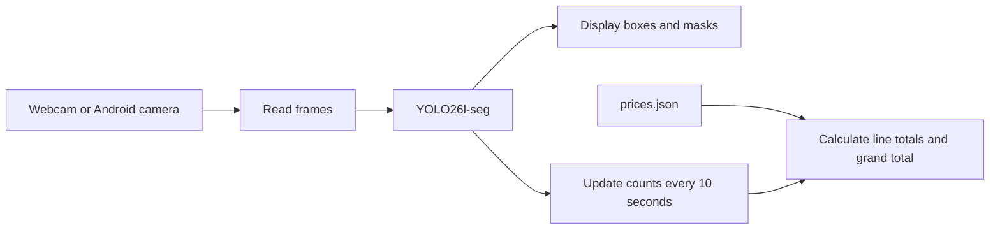

# CV_AI — Grocerystuffs Scanner

A product recognition project built with **YOLO26l-seg**, using a computer webcam
or an Android phone camera. The application displays a bounding box and instance
mask for each detected item, counts products, and calculates a total using a
configurable price list.

The current model has **31 product classes**. Images are labeled in Ultralytics,
exported as NDJSON, then prepared and used for training on Google Colab.

For a detailed explanation in Vietnamese, see
[Architecture and how YOLO learns from data](architect.md).

## Demo videos

https://github.com/user-attachments/assets/484366f0-63cc-4303-81c4-83253242a1fe

As you can see the cam is very lag because I am using my camera laptop without GPU (only CPU intel 7), so the performance was so bad. 
You can use a better laptop or PC with a VGA on it to improve the performance (increase FPS, low down the stuttering frame,...).

## Features

- Detect multiple products in one frame and display their boxes and masks.
- Show quantities, unit prices, line totals, and a grand total in VND.
- Populate the pricing panel on the first detection, then refresh every 10 seconds.
- Receive video from a webcam or a DroidCam stream over Wi-Fi.
- Continuously read webcam or phone video and keep only the latest pending frame for YOLO
  to reduce delays caused by a backlog of older frames.
- Train, save checkpoints, resume interrupted runs, and evaluate boxes/masks on Colab.

**Each scan is a snapshot of the items currently detected.** A new snapshot
replaces the previous one; counts do not accumulate across frames. Boxes and
masks update with every inference, while the pricing panel stays unchanged
between scans. The panel may therefore temporarily differ from the live view.

The camera application does not currently record video or save frames to disk.

## How it works



Live video capture keeps a single pending frame, replacing it whenever a newer
frame arrives. This reduces waiting for old frames; model inference speed still
depends on the hardware, input size, and image content.

https://github.com/user-attachments/assets/b7a2fce6-f393-49d6-9228-c2fe98c7f4e4

## Project structure

```text
CV_AI/
├── Detection/                     # 9 scripts corresponding to the Colab cells
│   ├── 00_install_dependencies.py
│   ├── 01_setup_drive.py
│   ├── 02_prepare_dataset.py
│   ├── 03_check_dataset.py
│   ├── 04_train_resume.py
│   ├── 05_show_results.py
│   ├── 06_test_model.py
│   ├── 07_download_model.py
│   ├── 08_list_checkpoints.py
│   └── README.md
├── cam_test/
│   ├── camera_app.py              # Camera connection picker
│   ├── camera_devices.py          # Named Windows camera discovery
│   ├── open_app.cmd               # Open the Windows picker
│   ├── webcam.py                  # Video capture, inference, counting, and pricing
│   ├── prices.json                # Unit prices in VND, keyed by class name
│   ├── run.cmd                    # Windows launcher
│   └── run_phone.cmd              # Launcher accepting the phone IP address
├── Grocerystuffs_Train.ipynb       # Colab notebook, including optional cell 6 fine-tune
├── CommonThings_Resume.ipynb      # Legacy CommonThings notebook
├── prepare_commonthings.py        # Legacy CommonThings utility
├── requirements.txt
├── .gitignore
└── README.md
```

The `best_grocery.pt` model, images, NDJSON files, and training outputs are stored
separately and excluded from the repository by `.gitignore`. Users cloning the
project must provide their own model/dataset. The legacy CommonThings tools are
separate from the current Grocerystuffs training workflow.

## Local setup

The current demo workflow runs on **Windows with Python 3.12**. Open a terminal
at the project root and install dependencies from the shared requirements file:

```powershell
python -m venv .venv
.\.venv\Scripts\python.exe -m pip install -r requirements.txt
```

Place the trained segmentation checkpoint at `CV_AI/best_grocery.pt`.
This is a custom product model; the original COCO weights do not provide the
same 31 labeled product classes. After training on Colab, download `best.pt`
and rename the local copy to `best_grocery.pt`.

## Run with a computer webcam

### Camera selection app

Launch the small Windows camera picker:

```powershell
.\cam_test\open_app.cmd
```

- **Device camera:** select a detected system camera by name, such as Integrated
  Webcam, DroidCam Video, or OBS Virtual Camera. Click **Refresh** after plugging
  in or unplugging a device. The picker does not open cameras while listing them.
- **Phone camera / IP (DroidCam):** connect both devices to the same Wi-Fi network, or
  connect the computer to the phone hotspot. Enter the IP and port shown in
  DroidCam (default port `4747`). Using a phone hotspot requires no router.

Both network setups use the same HTTP video connection, not Bluetooth.
Keep DroidCam open on the phone and exit its PC client when using a direct URL.
Click **Preview camera** to check video without loading YOLO. Close that video
window or click **Stop** before starting **YOLO**. Only one camera session runs
at a time; video and the pricing panel use the existing OpenCV window.

The app remembers the selected device identifier and last mode/IP/port locally in
`cam_test/camera_settings.json`, which is excluded from Git. Invalid addresses
and connection/model failures are reported in the picker. This interface does
not increase inference FPS or separate live display from model inference.

Device selection is remembered by its system identifier. If a saved device is
disconnected, select another camera or reconnect it and click **Refresh**.
The app rechecks the identifier before capture and does not silently switch to
another device when its numeric index changes. CLI users may still use
`--camera 0`, while the picker handles device names automatically.

### Export a PDF receipt

Start YOLO from the picker and wait for a nonempty scan. Click **Export invoice
PDF**, choose a filename, and save. The app freezes the latest received
10-second scan when you click, before opening the save dialog. The picker shows
its scan time and total; subsequent scans do not modify the saved PDF.

Each PDF includes a unique invoice ID, scan/export timestamps, product names,
quantities, unit prices, line totals, and the total in VND. Unpriced items are
listed as excluded; an all-unpriced scan has a zero priced-item total. Empty
scans cannot be exported. This is a demo receipt based on model predictions.

The default save folder is `exports/receipts/` (excluded from Git); another
location may be selected. Install the updated `requirements.txt` for ReportLab.
No camera image or video is included in the receipt.

### Command-line launch

```powershell
.\cam_test\run.cmd --camera 0
```

Press **Q** or **Escape** in the camera window to exit. If multiple webcams are
available, select the appropriate index with `--camera`. Index 1 does not
automatically refer to the phone camera.

| Argument | Default | Description |
|---|---|---|
| `--camera` | `0` | Webcam index or HTTP/HTTPS video URL |
| `--model` | `best_grocery.pt` at the project root | Inference checkpoint |
| `--imgsz` | `480` | YOLO input size |
| `--conf` | `0.25` | Confidence threshold for detections and counts |
| `--device` | `cpu` | Inference device |
| `--prices` | `cam_test/prices.json` | Unit price file |

To change the input size and confidence threshold:

```powershell
.\cam_test\run.cmd --camera 0 --imgsz 640 --conf 0.35
```

Larger inputs may preserve more detail but require more processing time. The
application uses the CPU by default. Use `--device 0` only when a CUDA-enabled
PyTorch installation and a compatible GPU are working.

## Use an Android camera over Wi-Fi

1. Open DroidCam on the phone and connect it to the same network as the computer.
2. Find the IP address and port displayed in the phone app.
3. If DroidCam Client is running on the computer, quit it through **File → Exit**
   to release the stream for Python. Closing its window may leave it running
   in the background.
4. Keep the phone app active and run the command with the actual phone IP:

```powershell
.\cam_test\run_phone.cmd PHONE_IP
```

Replace `PHONE_IP` with the address displayed in the app. The script adds port
`4747` and the `/video` path automatically. To use another port, pass the full
URL and replace the address and port with the values shown in the app:

```powershell
.\cam_test\run.cmd --camera "http://PHONE_IP:4747/video"
```

The phone supplies the video; the model runs and displays results on the
computer. This workflow does not require OBS. If the phone IP changes, update
the command rather than editing the code.

> **[TODO VIDEO 02 — PHONE CAMERA, 15–30 SECONDS]**
>
> **Insert the video link below this note.** Record both the phone and computer
> screen. Move a product back and forth, then place it in view for YOLO to detect.
> Show that the computer receives the phone video and responds to movement.
> Do not state a fixed latency or FPS in the video unless it has been measured.

<!-- TODO VIDEO 02: replace the note above with a link to the phone camera demo. -->

## Product prices and billing

[cam_test/prices.json](cam_test/prices.json) is the source of current unit prices.
Each key must exactly match a model class name, and each price must be a
non-negative integer in VND. An excerpt from the current configuration:

```json
{
  "Coca_Lon": 12000,
  "Pepsi_Lon": 15000
}
```

If a scan detects two Coca cans and one Pepsi can, the total is:
`2 × 12,000 + 1 × 15,000 = 39,000 VND`.

- Edit the JSON file and restart the camera application to load new prices.
- Items without a configured price are still counted, display `NO PRICE`, and
  are excluded from the total.
- `Unpriced` shows the number of items without a price. The total may cover only
  priced items, rather than every item visible in the image.
- If a new scan detects no items, the quantities and total reset to zero.

## Training and evaluation on Colab

### Open the Jupyter notebook

Open [Grocerystuffs_Train.ipynb](Grocerystuffs_Train.ipynb) using
[Google Colab](https://colab.research.google.com/github/Toriki1111/Goods-Dectection/blob/main/Grocerystuffs_Train.ipynb),
then save a copy to your Drive before editing. Alternatively, upload the `.ipynb`
file through **File → Upload notebook** in Colab. GitHub only previews the code;
it does not run training. The notebook uses `google.colab` for Drive and downloads,
so its current workflow is intended for Colab rather than local Jupyter/VS Code.

Select a GPU under **Runtime → Change runtime type**, then connect. Run one cell
at a time using its play button or **Shift+Enter**, waiting for it to finish.
Do not use **Run all**: cell 6 starts an optional new fine-tune, not a required
step after the original training. Published notebooks have saved outputs cleared;
this does not remove code or change checkpoints stored on your Drive.

| Notebook cell | Purpose / when to run |
|---|---|
| 0 | Install the notebook's training dependencies |
| 1 | Check GPU, mount Drive, and locate the original NDJSON snapshot |
| 2–3 | Prepare/restore and validate the original segmentation dataset |
| 4 | Train the original model or resume its interrupted run |
| 5 | View plots from the original run |
| **6 — FINE-TUNE (optional)** | Start a new run from the old best.pt using a separately prepared old + new dataset |
| 7 | Evaluate the **original** best.pt on the original test split |
| 8 | Download the **original** best.pt |
| 9 | List original epoch checkpoints and sizes; does not delete anything |

### Fine-tune with additional data: cell 6

1. Prepare the combined old + new dataset first. If the new NDJSON already
   contains old images, use it as the combined source rather than appending the
   old export again. Review duplicates and labels, preserve class IDs/order,
   and keep evaluation images/source groups out of training.
2. Convert that source into downloaded images, YOLO **segmentation** labels and
   `data.yaml`. Cell 6 consumes this YAML, not an NDJSON file. Adding files to
   `MoreData` or Drive alone does not update a training dataset.
3. Run cell 0 and mount Drive using cell 1. Cell 1 still checks the original
   snapshot; replacing its NDJSON with a new export will fail its fixed hash/count
   checks. Cells 2–3 prepare the old dataset, not your additional data.
4. In cell 6, set `FT_SOURCE_PT` to the old segmentation checkpoint and
   **`FT_DATA_YAML` to the combined dataset's actual YAML path**. The default
   expected path is `MyDrive/YOLO_Grocerystuffs/datasets/grocerystuffs_finetune/data.yaml`.
   This separate dataset is not created by cell 6. Its image/label paths must be
   valid in the current Colab runtime.
5. Run cell 6 only when ready. It verifies segmentation and the exact class-name
   mapping, then trains for up to **100 epochs**, with **patience 20**, image size
   **640**, AutoBatch at **70% VRAM**, and AdamW at **lr0=0.0001**.

This is a new training run initialized from learned weights (`resume=False`).
It writes to `MyDrive/YOLO_Grocerystuffs/runs/Grocerystuffs_Finetune_<timestamp>/`
and keeps the original run. The resulting paths are **`FT_BEST_PT`** and
**`FT_LAST_PT`**. Normal checkpoint saving updates last.pt each completed epoch
and best.pt when validation improves; extra periodic epoch files are disabled.
The provenance file records checkpoint/YAML hashes; the YAML hash is not a hash
of all dataset images and labels.

**Rerunning cell 6 starts another new run.** To continue an interrupted fine-tune,
restore the environment and dataset, find that run's unstripped `last.pt` on
Drive, and resume that checkpoint rather than rerunning cell 6 or original cell 4:

```python
from pathlib import Path
from ultralytics import YOLO

FT_DATA_YAML = Path("/path/to/the/restored/combined/data.yaml")
ft_resume = YOLO("/path/to/the/interrupted/finetune/weights/last.pt")
ft_resume.train(resume=True, data=str(FT_DATA_YAML), device=0, workers=2)
```

Completed runs may have optimizer state removed and cannot be resumed this way.
Cells 7 and 8 remain pointed at the original model. To evaluate/download the
fine-tuned model after it finishes, use the explicit fine-tune paths in separate
cells (the combined YAML must define a held-out test split for this example):

```python
ft_test = YOLO(str(FT_BEST_PT)).val(
    data=str(FT_DATA_YAML), split="test", imgsz=640, batch=4, device=0
)
```

```python
from google.colab import files
files.download(str(FT_BEST_PT))
```

Keep the same held-out set when comparing original and fine-tuned models. Use
validation for development and reserve test evaluation for the final comparison.

### Alternative: separate Python cell scripts

See [Detection/README.md](Detection/README.md) for the older 00–08 scripts, run
with `%run -i` in the same Colab runtime. Their numbering differs from the
updated notebook; they do **not** include its optional fine-tune cell 6. Although
the folder is named Detection, the configured task is **instance segmentation**.

| Section | Purpose |
|---|---|
| 00–01 | Install requirements, check the GPU, and mount Google Drive |
| 02–03 | Split by source group, validate images/polygons, and back up the dataset |
| 04 | Train or resume an unfinished checkpoint |
| 05–06 | View plots and evaluate best.pt on the test split |
| 07–08 | Download the model and list epoch checkpoints |

| Current training configuration | Value |
|---|---|
| Starting model | Pretrained `yolo26l-seg.pt` |
| Classes | 31 |
| Dataset snapshot | 904 images: train 720 / val 88 / test 96 |
| Maximum epochs / patience | 100 / 20 |
| Training image size | 640 |
| Batch | AutoBatch, targeting 70% VRAM |
| Optimizer / initial learning rate | AdamW / 0.0005 |
| Periodic checkpoints | Every 5 epochs, in addition to best.pt and last.pt |

Dataset checks are fixed to the existing snapshot and its hashes. Additional
images in MoreData are not automatically included in this run. When changing
the dataset, update the snapshot and its image count, class, and hash checks.

Model checkpoints are saved on Drive at:

```text
MyDrive/YOLO_Grocerystuffs/runs/Grocerystuffs_Seg_20261029/weights/
├── best.pt
└── last.pt
```

If the runtime disconnects, restore the environment and dataset using sections
00–03, then run section 04 to resume. The script prevents restarting a completed
run in the same output directory.

## Current limitations

- Missed detections or incorrect classes affect counts and totals. This is a
  demonstration of pricing based on visual recognition.
- The pricing panel uses a single inference result at each refresh. It does not
  combine multiple frames for confirmation or track a shopping basket.
- Dropping old frames reduces queue delays but does not eliminate every source
  of video latency.
- A large model may run at a low FPS on a CPU; performance varies across machines.
- Checkpoints and datasets must be supplied separately when sharing the project.
