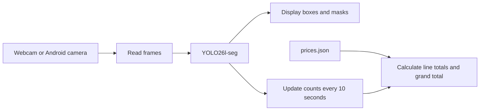

# CV_AI — Grocerystuffs Scanner

A product recognition project built with **YOLO26l-seg**, using a computer webcam
or an Android phone camera. The application displays a bounding box and instance
mask for each detected item, counts products, and calculates a total using a
configurable price list.

The current model has **31 product classes**. Images are labeled in Ultralytics,
exported as NDJSON, then prepared and used for training on Google Colab.

## Demo videos

https://github.com/user-attachments/assets/484366f0-63cc-4303-81c4-83253242a1fe

## Features

- Detect multiple products in one frame and display their boxes and masks.
- Show quantities, unit prices, line totals, and a grand total in VND.
- Populate the pricing panel on the first detection, then refresh every 10 seconds.
- Receive video from a webcam or a DroidCam stream over Wi-Fi.
- Continuously read phone video and keep only the latest pending frame for YOLO
  to reduce delays caused by a backlog of older frames.
- Train, save checkpoints, resume interrupted runs, and evaluate boxes/masks on Colab.

**Each scan is a snapshot of the items currently detected.** A new snapshot
replaces the previous one; counts do not accumulate across frames. Boxes and
masks update with every inference, while the pricing panel stays unchanged
between scans. The panel may therefore temporarily differ from the live view.

The camera application does not currently record video or save frames to disk.

## How it works



Phone video capture keeps a single pending frame, replacing it whenever a newer
frame arrives. This reduces waiting for old frames; model inference speed still
depends on the hardware, input size, and image content.

## Project structure

```text
CV_AI/
├── Detection/                     # 9 scripts corresponding to the Colab cells
│   ├── 00_install_dependencies.py
│   ├── 01_setup_drive.py
│   ├── 02_prepare_dataset.py
│   ├── 03_check_dataset.py
│   ├── 04_train_resume.py
│   ├── 05_show_results.py
│   ├── 06_test_model.py
│   ├── 07_download_model.py
│   ├── 08_list_checkpoints.py
│   └── README.md
├── cam_test/
│   ├── webcam.py                  # Video capture, inference, counting, and pricing
│   ├── prices.json                # Unit prices in VND, keyed by class name
│   ├── run.cmd                    # Windows launcher
│   └── run_phone.cmd              # Launcher accepting the phone IP address
├── Grocerystuffs_Train.ipynb       # Local notebook saved before splitting into scripts
├── CommonThings_Resume.ipynb      # Legacy CommonThings notebook
├── prepare_commonthings.py        # Legacy CommonThings utility
├── requirements.txt
├── .gitignore
└── README.md
```

The `best_grocery.pt` model, images, NDJSON files, and training outputs are stored
separately and excluded from the repository by `.gitignore`. Users cloning the
project must provide their own model/dataset. The legacy CommonThings tools are
separate from the current Grocerystuffs training workflow.

## Local setup

The current demo workflow runs on **Windows with Python 3.12**. Open a terminal
at the project root and install dependencies from the shared requirements file:

```powershell
python -m venv .venv
.\.venv\Scripts\python.exe -m pip install -r requirements.txt
```

Place the trained segmentation checkpoint at `CV_AI/best_grocery.pt`.
This is a custom product model; the original COCO weights do not provide the
same 31 labeled product classes. After training on Colab, download `best.pt`
and rename the local copy to `best_grocery.pt`.

## Run with a computer webcam

```powershell
.\cam_test\run.cmd --camera 0
```

Press **Q** or **Escape** in the camera window to exit. If multiple webcams are
available, select the appropriate index with `--camera`. Index 1 does not
automatically refer to the phone camera.

| Argument | Default | Description |
|---|---|---|
| `--camera` | `0` | Webcam index or HTTP/HTTPS video URL |
| `--model` | `best_grocery.pt` at the project root | Inference checkpoint |
| `--imgsz` | `480` | YOLO input size |
| `--conf` | `0.25` | Confidence threshold for detections and counts |
| `--device` | `cpu` | Inference device |
| `--prices` | `cam_test/prices.json` | Unit price file |

To change the input size and confidence threshold:

```powershell
.\cam_test\run.cmd --camera 0 --imgsz 640 --conf 0.35
```

Larger inputs may preserve more detail but require more processing time. The
application uses the CPU by default. Use `--device 0` only when a CUDA-enabled
PyTorch installation and a compatible GPU are working.

## Use an Android camera over Wi-Fi

1. Open DroidCam on the phone and connect it to the same network as the computer.
2. Find the IP address and port displayed in the phone app.
3. If DroidCam Client is running on the computer, quit it through **File → Exit**
   to release the stream for Python. Closing its window may leave it running
   in the background.
4. Keep the phone app active and run the command with the actual phone IP:

```powershell
.\cam_test\run_phone.cmd PHONE_IP
```

Replace `PHONE_IP` with the address displayed in the app. The script adds port
`4747` and the `/video` path automatically. To use another port, pass the full
URL and replace the address and port with the values shown in the app:

```powershell
.\cam_test\run.cmd --camera "http://PHONE_IP:4747/video"
```

The phone supplies the video; the model runs and displays results on the
computer. This workflow does not require OBS. If the phone IP changes, update
the command rather than editing the code.

> **[TODO VIDEO 02 — PHONE CAMERA, 15–30 SECONDS]**
>
> **Insert the video link below this note.** Record both the phone and computer
> screen. Move a product back and forth, then place it in view for YOLO to detect.
> Show that the computer receives the phone video and responds to movement.
> Do not state a fixed latency or FPS in the video unless it has been measured.

<!-- TODO VIDEO 02: replace the note above with a link to the phone camera demo. -->

## Product prices and billing

[cam_test/prices.json](cam_test/prices.json) is the source of current unit prices.
Each key must exactly match a model class name, and each price must be a
non-negative integer in VND. An excerpt from the current configuration:

```json
{
  "Coca_Lon": 12000,
  "Pepsi_Lon": 15000
}
```

If a scan detects two Coca cans and one Pepsi can, the total is:
`2 × 12,000 + 1 × 15,000 = 39,000 VND`.

- Edit the JSON file and restart the camera application to load new prices.
- Items without a configured price are still counted, display `NO PRICE`, and
  are excluded from the total.
- `Unpriced` shows the number of items without a price. The total may cover only
  priced items, rather than every item visible in the image.
- If a new scan detects no items, the quantities and total reset to zero.

## Training and evaluation on Colab

See [Detection/README.md](Detection/README.md) for running the scripts in order
within the same runtime. Although the folder is named Detection, the configured
task is **instance segmentation**.

| Section | Purpose |
|---|---|
| 00–01 | Install requirements, check the GPU, and mount Google Drive |
| 02–03 | Split by source group, validate images/polygons, and back up the dataset |
| 04 | Train or resume an unfinished checkpoint |
| 05–06 | View plots and evaluate best.pt on the test split |
| 07–08 | Download the model and list epoch checkpoints |

| Current training configuration | Value |
|---|---|
| Starting model | Pretrained `yolo26l-seg.pt` |
| Classes | 31 |
| Dataset snapshot | 904 images: train 720 / val 88 / test 96 |
| Maximum epochs / patience | 100 / 20 |
| Training image size | 640 |
| Batch | AutoBatch, targeting 70% VRAM |
| Optimizer / initial learning rate | AdamW / 0.0005 |
| Periodic checkpoints | Every 5 epochs, in addition to best.pt and last.pt |

Dataset checks are fixed to the existing snapshot and its hashes. Additional
images in MoreData are not automatically included in this run. When changing
the dataset, update the snapshot and its image count, class, and hash checks.

Model checkpoints are saved on Drive at:

```text
MyDrive/YOLO_Grocerystuffs/runs/Grocerystuffs_Seg_20261029/weights/
├── best.pt
└── last.pt
```

If the runtime disconnects, restore the environment and dataset using sections
00–03, then run section 04 to resume. The script prevents restarting a completed
run in the same output directory.

> **[TODO VIDEO 03 — TRAINING / RESUME, OPTIONAL, 20–30 SECONDS]**
>
> **Insert the video link below this note if you want to present the workflow.**
> Record the split summary after dataset validation, training logs, and the
> weights folder containing checkpoints. For a resume demonstration, show the
> continuing epoch of a run that was actually interrupted; there is no need to
> repeat training solely to record a video.

<!-- TODO VIDEO 03: add a training/resume video link, or omit this optional block. -->

## Current limitations

- Missed detections or incorrect classes affect counts and totals. This is a
  demonstration of pricing based on visual recognition.
- The pricing panel uses a single inference result at each refresh. It does not
  combine multiple frames for confirmation or track a shopping basket.
- Dropping old frames reduces queue delays but does not eliminate every source
  of video latency.
- A large model may run at a low FPS on a CPU; performance varies across machines.
- Checkpoints and datasets must be supplied separately when sharing the project.

## Adding videos and publishing to GitHub

After recording, edit the README on GitHub, upload a clip in the editor or paste
an accessible video link, and replace the corresponding `TODO VIDEO` blocks.
Video 01 is the main demo, video 02 demonstrates the phone camera, and video 03
is optional for presenting training. If hosting videos elsewhere, keep the
links accessible to repository viewers.

Before committing, review the files to be published. `.gitignore` excludes
datasets, NDJSON files containing signed URLs, model weights, `.venv`, and
training outputs. Adding a file to `.gitignore` does not remove it from Git
history if it was already tracked.
