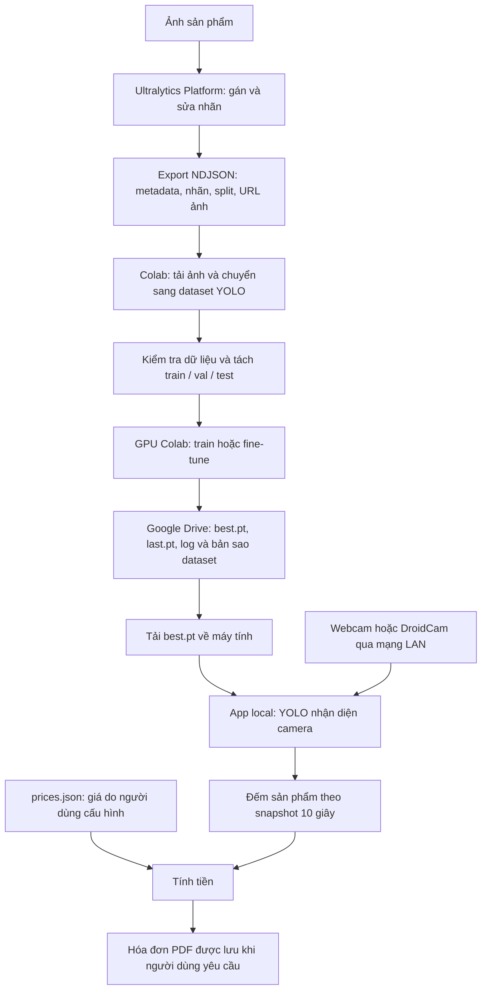
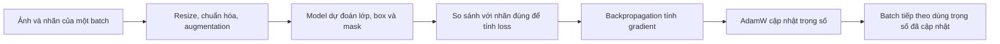

# Kiến trúc dự án và cách YOLO học từ dữ liệu

Tài liệu mô tả luồng đang có trong dự án: **gán nhãn trên Ultralytics Platform →
xuất NDJSON → chuẩn bị dataset → train/fine-tune trên Google Colab → tải model
về máy → nhận diện camera và xuất hóa đơn**.

Model chính là **YOLO26l-seg**, bài toán **instance segmentation** với 31 lớp sản
phẩm. Model trả về loại sản phẩm, độ tin cậy, bounding box và mặt nạ của từng
vật thể. Mỗi lớp là một loại sản phẩm theo bộ nhãn; không phải mã định danh duy
nhất cho từng món hàng vật lý.

## 1. Toàn cảnh: phần nào online, phần nào local?



| Thành phần | Chạy/lưu ở đâu? | Công việc | Có cập nhật trọng số model không? |
|---|---|---|---|
| Ultralytics Platform | Dịch vụ web | Quản lý ảnh, gán nhãn, xuất dataset | Không phải bước train của pipeline đang mô tả |
| File NDJSON | Tải về máy hoặc đưa lên Drive/Colab | Mô tả dữ liệu, nhãn và nơi lấy ảnh | Không |
| Chuẩn bị dataset | CPU và ổ đĩa của runtime Colab | Tải ảnh, đổi định dạng, kiểm tra và sao lưu | Không |
| Train/fine-tune | GPU của runtime Colab | Tính loss, gradient và cập nhật trọng số | **Có** |
| Google Drive | Lưu trữ đám mây | Giữ checkpoint, dataset ZIP và thông tin lượt train | Không tự train |
| App camera | Máy tính Windows | Nạp `.pt`, dự đoán, đếm và tính tiền | **Không** |
| DroidCam | Điện thoại và kết nối LAN | Cung cấp luồng video cho máy tính | Không |
| GitHub | Kho mã nguồn | Lưu code, notebook, tài liệu và requirements | Không tự chạy notebook/train |

**Trong dự án này, “train online” có thể được hiểu là train trên cloud Colab.**
Đó không phải **online learning** theo nghĩa model tự cập nhật liên tục mỗi khi
nhìn thấy một ảnh mới. Luồng hiện tại là học có giám sát theo từng lượt train;
webcam chỉ suy luận, không tự học.

## 2. Dữ liệu dạy model điều gì?

Mỗi ảnh huấn luyện cần hai phần đi cùng nhau:

1. **Nội dung ảnh:** pixel thể hiện màu sắc, hình dạng, bao bì, góc nhìn và bối cảnh.
2. **Nhãn đúng:** vật thuộc lớp nào và nằm ở đâu; với segmentation còn có đường
   bao của từng vật thể.

Ví dụ ảnh có ba lon Coca và một lon Pepsi thì cần nhãn cho **từng lon**. Model
phải học phân biệt cả loại sản phẩm lẫn từng đối tượng riêng biệt. Không khoanh
một polygon chung cho cả cụm nếu mục tiêu là đếm từng sản phẩm.

Model không đọc tên file như một đáp án và không học bằng cách ghi nhớ danh sách
URL. Nó dùng ảnh làm đầu vào và dùng nhãn làm mục tiêu để so sánh với dự đoán.
Tên lớp chỉ ánh xạ một class ID sang tên dễ đọc; màu vẽ nhãn trên màn hình không
phải một phần thông tin cần “in” lên ảnh để model học.

**Giá bán không được học từ dataset hình ảnh hiện tại.** Giá được tra từ
[cam_test/prices.json](cam_test/prices.json) sau khi model nhận diện ra tên lớp.

## 3. NDJSON là gì và chứa gì?

NDJSON là định dạng văn bản: **mỗi dòng là một đối tượng JSON độc lập**. File xuất
của Ultralytics có bản ghi mô tả dataset và các bản ghi mô tả ảnh.

Ví dụ dưới đây chỉ minh họa hai lớp giả định, **không phải danh sách class ID của
model 31 lớp trong dự án**, và không phải file để nhập trực tiếp cho lượt train
hiện tại. URL cũng là địa chỉ minh họa.

```jsonl
{"type":"dataset","task":"segment","name":"vi_du_san_pham","class_names":{"0":"San_pham_A","1":"San_pham_B"}}
{"type":"image","file":"anh_001.jpg","url":"https://example.com/anh_001.jpg","width":1280,"height":720,"split":"train","annotations":{"segments":[[0,0.10,0.20,0.30,0.20,0.30,0.80,0.10,0.80],[1,0.55,0.25,0.75,0.25,0.75,0.85,0.55,0.85]]}}
```

| Trường | Ý nghĩa |
|---|---|
| `type: dataset` | Thông tin chung của bộ dữ liệu |
| `task: segment` | Bài toán instance segmentation |
| `class_names` | Ánh xạ class ID sang tên sản phẩm |
| `type: image` | Một ảnh cùng thông tin và nhãn của nó |
| `file` | Tên ảnh trong bản xuất; tên ảnh sau chuyển đổi có thể khác |
| `url` | Địa chỉ tải nội dung ảnh |
| `width`, `height` | Kích thước ảnh được khai báo trong bản ghi |
| `split` | Nhóm `train`, `val` hoặc `test` |
| `annotations.segments` | Danh sách polygon, mỗi phần tử mô tả một instance |

Trong ví dụ, polygon có dạng:

```text
[class_id, x1, y1, x2, y2, ..., xn, yn]
```

Các tọa độ được chuẩn hóa theo kích thước ảnh: `x = pixel_x / chiều_rộng`,
`y = pixel_y / chiều_cao`. Ví dụ `x = 0.5` là giữa chiều ngang ảnh. Một polygon
cần ít nhất ba điểm; không được dùng tọa độ bounding box thay cho polygon.

Với **detection**, nhãn box thường có dạng
`[class_id, x_center, y_center, width, height]`, cũng được chuẩn hóa. Hai dạng
nhãn này phục vụ hai bài toán khác nhau. Dự án Grocerystuffs hiện dùng `segments`.

**File NDJSON trong luồng xuất này không chứa sẵn toàn bộ pixel ảnh.** Nó chứa
nhãn và tham chiếu tới ảnh. Vì vậy chỉ có NDJSON mà URL ảnh hết hạn, không truy
cập được và không có ảnh/bản sao dataset thì chưa đủ để train.

Tham khảo định dạng từ [Ultralytics Dataset Management](https://docs.ultralytics.com/platform/data/datasets)
và [định dạng nhãn segmentation](https://docs.ultralytics.com/datasets/segment).

## 4. Từ NDJSON sang bộ dữ liệu YOLO dùng để train

Ở luồng hiện tại, code đọc NDJSON để kiểm tra metadata, nhãn, nhóm nguồn và split;
sau đó dùng `convert_ndjson_to_yolo` để tạo dataset trên ổ đĩa runtime Colab.
Quá trình chuyển đổi này **chưa huấn luyện model**.

Các công việc gồm:

1. Đọc ánh xạ class ID, split và nhãn của các bản ghi ảnh.
2. Lấy nội dung ảnh từ URL khi cần tải dataset.
3. Tạo file nhãn `.txt` tương ứng với ảnh.
4. Tạo `data.yaml` để chỉ nơi lưu ảnh và khai báo tên lớp.
5. Kiểm tra ảnh đọc được, nhãn hợp lệ và ảnh không lẫn giữa các split.

Lời gọi minh họa khi dùng trong một cell Colab:

```python
from pathlib import Path
from ultralytics.data.converter import convert_ndjson_to_yolo

DATA_YAML = Path(
    await convert_ndjson_to_yolo(
        str(NDJSON_PATH),
        output_path=str(WORK_DIR / "converted"),
    )
)
```

`NDJSON_PATH` và `WORK_DIR` phải trỏ tới dữ liệu/thư mục của lượt đang chuẩn bị.
Đây là minh họa chuyển đổi, không thay thế các bước kiểm tra dataset của dự án.
Các file `.py` trong `Detection` xử lý converter qua event loop riêng để dùng
được với cách chạy `%run -i`. Xem [API converter](https://docs.ultralytics.com/reference/data/converter).

Cấu trúc kết quả thường có dạng sau; thư mục con do converter tạo có thể kèm
hậu tố, nên lấy đường dẫn trả về thay vì tự đoán tên:

```text
dataset_yolo/
├── data.yaml
├── images/
│   ├── train/
│   │   └── anh_001.jpg
│   ├── val/
│   └── test/
└── labels/
    ├── train/
    │   └── anh_001.txt
    ├── val/
    └── test/
```

Một file nhãn segmentation có thể chứa nhiều dòng, mỗi dòng là một vật:

```text
0 0.10 0.20 0.30 0.20 0.30 0.80 0.10 0.80
1 0.55 0.25 0.75 0.25 0.75 0.85 0.55 0.85
```

`data.yaml` minh họa tương ứng:

```yaml
path: /content/dataset_yolo
train: images/train
val: images/val
test: images/test
names:
  0: San_pham_A
  1: San_pham_B
```

**`data.yaml` là cấu hình, không phải model và cũng không phải dữ liệu ảnh.**
Lệnh `model.train(data=...)` trong notebook trỏ tới YAML này; DataLoader mới đọc
ảnh và nhãn thật từ các đường dẫn được khai báo.

Nếu đã có đầy đủ bộ ảnh/nhãn đúng cấu trúc YOLO thì có thể train bằng dataset đó,
không bắt buộc tải lại ảnh từ cloud. Một folder ảnh raw riêng lẻ chưa tự trở thành
dataset YOLO: vẫn phải ghép được đúng ảnh với đúng nhãn và split.

## 5. Train, validation và test khác nhau ở đâu?

| Split | Được dùng khi nào? | Vai trò |
|---|---|---|
| `train` | Trong các bước tối ưu của từng epoch | Ảnh và nhãn dùng để tính loss và gradient cập nhật trọng số |
| `val` | Sau mỗi epoch khi bật validation | Đo chất lượng, chọn model tốt nhất và quyết định dừng sớm; không dùng để cập nhật trọng số bằng gradient |
| `test` | Khi đã chốt mô hình/cấu hình | Đánh giá trên tập giữ riêng; không dùng để chỉnh model lặp đi lặp lại |

Ảnh giống nhau, ảnh tăng cường từ cùng một ảnh gốc hoặc các khung liên tiếp của
cùng cảnh nên được quản lý theo nhóm nguồn. Chia ngẫu nhiên từng file có thể đưa
những ảnh rất giống nhau sang cả train và test, khiến kết quả đánh giá quá lạc quan.

Với snapshot Grocerystuffs hiện được ghi trong code:

- Bản nguồn: **918 ảnh**, **31 lớp**.
- Loại **14 ảnh sản phẩm chưa có nhãn polygon** khỏi snapshot train; giữ nguyên
  dữ liệu nguồn. Chúng không được coi là ảnh nền âm tính hợp lệ chỉ vì thiếu nhãn.
- Sau lọc: **904 ảnh**, gồm **720 train / 88 val / 96 test**.
- Bản chuẩn bị có 1.827 polygon; kiểm tra sau chuyển đổi ghi nhận 1.826 polygon
  duy nhất sau khi chuẩn hóa một nhãn trùng chính xác.
- Một số lớp rất ít mẫu hoặc không có mẫu; việc tên lớp có trong cấu hình không
  có nghĩa model đã được học đầy đủ lớp đó.

Các số trên thuộc **snapshot cũ được cố định bằng hash trong cell 1–3**, không
phải số lượng tự cập nhật mỗi khi có file NDJSON mới. Code hiện chặn dữ liệu
không khớp thay vì tự bỏ qua các kiểm tra.

## 6. Model thực sự học như thế nào?

### 6.1. Trọng số ban đầu

Lượt train gốc dùng:

```python
model = YOLO("yolo26l-seg.pt")
```

Đó là khởi tạo từ trọng số pretrained, rồi học trên dữ liệu sản phẩm của mình.
Không phải train từ đầu chỉ vì có `data.yaml`: cần phân biệt **YAML dataset** với
**YAML kiến trúc model** dùng khi khởi tạo một mạng chưa có trọng số pretrained.

Ở mức khái quát, mạng có phần trích xuất đặc trưng ảnh (backbone), phần kết hợp
đặc trưng ở nhiều kích thước (neck), và phần dự đoán loại/vị trí/mặt nạ (head).
Code huấn luyện của Ultralytics quản lý các thành phần và phép tính này.

### 6.2. Một bước học



Cụ thể:

1. DataLoader lấy một batch ảnh cùng nhãn; kích thước đầu vào train hiện là 640.
2. Khi bật augmentation, hệ thống biến đổi ảnh và biến đổi tọa độ nhãn tương ứng.
   Ví dụ ảnh lật ngang thì polygon/box cũng phải lật theo.
3. Mạng tính dự đoán bằng trọng số hiện tại; ban đầu có thể bỏ sót hoặc nhầm sản phẩm.
4. Hàm loss đo sai lệch về phân loại, vị trí và mặt nạ. Tên/thành phần loss cụ thể
   tùy phiên bản và kiến trúc; không nên áp nguyên tên loss của YOLO đời khác.
5. PyTorch tính gradient bằng backpropagation; optimizer AdamW dùng gradient và
   learning rate để điều chỉnh trọng số. Với gradient accumulation, cập nhật
   optimizer có thể diễn ra sau nhiều batch, không nhất thiết sau từng batch.
6. Quá trình lặp qua tập train tạo thành một epoch; nhiều epoch giúp model tiếp
   tục điều chỉnh, nhưng không bảo đảm chất lượng cứ tăng mãi.
7. Validation đo khả năng tổng quát hóa. Nếu chất lượng ngừng cải thiện, patience
   cho phép dừng sớm thay vì tiếp tục học quá mức trên tập train.

Đây là giải thích nguyên lý, **không phải model tự sửa các nhãn của người dùng**.
Train bình thường coi nhãn là đáp án; nhãn sai/thiếu có thể dạy model sai.
Việc giảm loss train cũng không tự chứng minh chất lượng trên ảnh mới tăng.
Tham khảo [vòng lặp tối ưu của PyTorch](https://docs.pytorch.org/tutorials/beginner/basics/optimization_tutorial.html).

### 6.3. Ví dụ dễ hình dung

Ảnh có hai lon Coca và được gán đúng hai instance. Model chỉ tìm thấy một lon thì
các thành phần loss phản ánh phần dự đoán chưa khớp mục tiêu. Sau nhiều bước cập
nhật trên nhiều ảnh và tình huống, model có thể học tốt hơn các đặc trưng của lon
Coca. Một ảnh không trực tiếp tạo ra một “quy tắc nhớ” cố định và không bảo đảm
chỉ một lần cập nhật là model đã nhận diện đúng mọi góc nhìn.

Nếu bộ ảnh chỉ toàn một góc chính diện, model có thể vẫn yếu khi gặp mặt sau,
che khuất hoặc ánh sáng khác. Số ảnh cần được xem cùng độ đa dạng, chất lượng
nhãn và độ giống với cảnh dùng thật, không chỉ tổng số file.

## 7. Train gốc, fine-tune và resume

| Luồng | Bắt đầu từ đâu? | Dữ liệu | Mục đích |
|---|---|---|---|
| Train sản phẩm lần đầu | Pretrained `yolo26l-seg.pt` | Dataset sản phẩm đã chuẩn bị | Học các lớp riêng của dự án |
| Fine-tune thêm | `best.pt` của model sản phẩm đã train | Dataset đã chuẩn bị lại, thường trộn dữ liệu cũ + mới | Mở lượt học mới từ kiến thức đã có |
| Resume | `last.pt` của lượt bị ngắt, còn trạng thái cần thiết | Giữ đúng dataset và cấu hình tương ứng | Tiếp tục lượt đang dang dở |
| Inference camera | `best_grocery.pt` đã tải về | Khung hình đầu vào, không cần nhãn để dự đoán | Nhận diện; không cập nhật trọng số |

### Luồng hiện tại trong notebook

- **Cell 4:** train gốc tối đa 100 epoch, patience 20, AdamW `lr0=0.0005`;
  nếu có checkpoint chưa hoàn tất và đúng provenance thì resume lượt gốc.
- **Cell 6:** tùy chọn fine-tune từ model sản phẩm cũ; tối đa **100 epoch**,
  patience **20**, AdamW `lr0=0.0001`, `resume=False`, tạo tên run mới theo thời gian.
- Cả hai dùng ảnh train kích thước 640 và AutoBatch với mục tiêu 70% VRAM; đây
  là cấu hình của code, không phải bảo đảm GPU lúc nào cũng dùng đúng 70%.

Cell 6 có đường dẫn riêng:

```text
Model khởi tạo:
MyDrive/YOLO_Grocerystuffs/runs/Grocerystuffs_Seg_20261029/weights/best.pt

Dataset để fine-tune, cần tự chuẩn bị rồi sửa FT_DATA_YAML cho đúng:
MyDrive/YOLO_Grocerystuffs/datasets/grocerystuffs_finetune/data.yaml

Kết quả lượt mới:
MyDrive/YOLO_Grocerystuffs/runs/Grocerystuffs_Finetune_<timestamp>/weights/
├── best.pt
└── last.pt
```

Cell 6 **không tự tải NDJSON mới, trộn ảnh mới hay tạo `data.yaml`**. Nó kiểm tra
class names/order của YAML khớp model cũ rồi dùng dataset đã có. Khi cần thêm
class ID mới, phải thiết kế lại bước ánh xạ/kiểm tra; không chỉ nối tên vào file
mà kỳ vọng cell hiện tại vẫn tự chạy.

Nếu NDJSON mới đã có ảnh cũ thì không ghép nguyên bản cũ thêm lần nữa. Cần kiểm
tra ảnh trùng, giữ bản nhãn đúng đã chỉnh, bảo toàn tập đánh giá và chuẩn bị một
dataset tổng nhất quán. Nhóm ảnh mới không được đưa lẫn bản sao sang train/test.

**Thêm ảnh chỉ có tác dụng khi ảnh và nhãn đó thực sự được đưa vào dataset mà
`FT_DATA_YAML` trỏ tới.** Chép ảnh vào MoreData hoặc upload NDJSON lên Drive chưa
khiến model tự học thêm.

Dữ liệu mới gán nhãn bằng người dùng rồi train lại vẫn là **supervised learning**.
Chỉ khi bổ sung một quy trình dùng dữ liệu chưa nhãn/pseudo-label có kiểm soát mới
bàn đến semi-supervised learning; dự án hiện chưa triển khai quy trình đó.

## 8. Checkpoint giữ gì và vì sao cần Drive?

- `best.pt`: checkpoint được chọn theo chất lượng validation trong lượt train,
  không đơn giản là checkpoint của epoch cuối.
- `last.pt`: checkpoint gần nhất đã được lưu; trong lượt chưa hoàn tất, trạng
  thái optimizer/epoch cần cho resume phải còn hợp lệ.
- Khi training kết thúc, optimizer có thể bị loại khỏi checkpoint. Đuôi `.pt`
  hoặc tên `last.pt` không tự bảo đảm có thể resume.
- Các file JSON provenance ghi nguồn dữ liệu/checkpoint để đối chiếu. Hash YAML
  chỉ đại diện cho cấu hình YAML, không chứng minh toàn bộ ảnh và nhãn không đổi.

Ổ `/content` là ổ làm việc của runtime Colab, có thể mất khi runtime bị xóa/reset.
Google Drive được mount vào runtime để giữ checkpoint và bản sao dataset ZIP.
GPU mất kết nối giữa epoch không bảo đảm phần epoch đang chạy đã kịp lưu.

Lượt train gốc có `save_period=5` nên có thêm checkpoint định kỳ mỗi 5 epoch.
Cell 6 dùng `save_period=-1`: không tạo các file epoch định kỳ, nhưng vẫn bật lưu
best/last theo chu trình training. Chạy lại Cell 6 tạo run mới, không tự tìm
`last.pt` của lượt fine-tune trước để resume.

## 9. Online/cloud và local khác nhau thế nào khi train?

| Cách chạy | Model học ở đâu? | Ảnh phải có ở đâu? | Ghi chú |
|---|---|---|---|
| Luồng Colab đang có | GPU cloud của Colab | Ổ runtime hoặc đường dẫn Drive truy cập được | Trình duyệt chỉ điều khiển notebook; laptop không phải GPU đang train |
| Train local bằng Ultralytics | CPU/GPU của máy local | Ổ đĩa/đường dẫn máy local truy cập được | Cần môi trường và dataset hợp lệ; notebook hiện có các API riêng của Colab |
| Train trên Ultralytics Platform | Dịch vụ của nền tảng | Theo cấu hình dịch vụ | Là một lựa chọn khác, không phải luồng train trong notebook này |

Với local, sau khi đã có dataset và môi trường phù hợp, nguyên lý lệnh là:

```python
from ultralytics import YOLO

model = YOLO("best_grocery.pt")
model.train(
    data="D:/CV_AI/datasets/bo_du_lieu_moi/data.yaml",
    epochs=100,
    imgsz=640,
    project="D:/CV_AI/runs",
    name="finetune_local",
)
```

Đây là **minh họa**, chưa được thực thi và đường dẫn dataset cần thay bằng dữ
liệu có thật. Thiết bị train phụ thuộc môi trường/tham số; có GPU trên máy không
đồng nghĩa PyTorch hiện cài đã hỗ trợ CUDA. Internet cần cho các bước tải dữ liệu,
trọng số hoặc thư viện; sau khi đã có đủ tài nguyên local thì phép học không cần
đọc liên tục từ website chỉ vì nguồn ban đầu là NDJSON.

## 10. Khi đem model về chạy camera

Luồng local nằm trong [cam_test/camera_app.py](cam_test/camera_app.py) và
[cam_test/webcam.py](cam_test/webcam.py):

1. Chọn camera thiết bị theo tên hoặc camera điện thoại qua IP DroidCam.
2. App mở một tiến trình camera/YOLO. Điện thoại chỉ truyền video; máy tính
   chạy model. Wi-Fi chung và hotspot đều dùng cùng kiểu kết nối IP.
3. `LatestFrameCamera` đọc liên tục và giữ một khung mới nhất đang chờ trong RAM.
   Nếu YOLO chưa xử lý xong, khung mới thay khung cũ, không tích hàng dài.
4. `model.predict(...)` tạo dự đoán. Không có bước tính gradient/cập nhật trọng số
   như lúc train; file `.pt` không tự học thêm từ video.
5. Box và mask được vẽ sau mỗi lần suy luận. Bảng số lượng và tiền chốt lần đầu,
   rồi cập nhật khoảng mỗi 10 giây từ snapshot nhận diện; kết quả mới thay kết quả
   cũ, không cộng dồn qua các khung hình.
6. Giá được tra theo tên lớp trong `prices.json`; món thiếu giá vẫn đếm nhưng
   không cộng tiền. PDF đóng băng snapshot khi người dùng yêu cầu xuất.

**Không lưu hàng dài trong RAM không có nghĩa hoàn toàn không dùng RAM.**
Chương trình vẫn cần RAM cho khung hiện tại, tensor, model và kết quả. Cách giữ
khung mới nhất giảm độ trễ do tồn khung; không tự làm model xử lý nhiều FPS hơn.
Hiện hiển thị kết quả vẫn gắn với vòng suy luận; model chậm thì hình có thể giật.

App không ghi video hay lưu từng frame theo luồng hiện tại. Nó chỉ lưu cấu hình
kết nối và hóa đơn khi được yêu cầu. Camera/DroidCam không phải nguồn dữ liệu
train tự động; muốn dùng ảnh camera để cải thiện model phải xây quy trình thu
thập, gán nhãn, kiểm tra, bổ sung dataset và train lại riêng.

## 11. Các file chính và trách nhiệm

| File/thư mục | Vai trò |
|---|---|
| [Grocerystuffs_Train.ipynb](Grocerystuffs_Train.ipynb) | Notebook Colab chính, có Cell 6 fine-tune tùy chọn |
| [Detection/README.md](Detection/README.md) | Cách dùng bản tách script 00–08 cũ; số cell không đồng nhất với notebook mới |
| [Detection/02_prepare_dataset.py](Detection/02_prepare_dataset.py) | Chuẩn bị split theo nhóm, chuyển NDJSON hoặc khôi phục ZIP |
| [Detection/03_check_dataset.py](Detection/03_check_dataset.py) | Kiểm tra ảnh/nhãn, đối chiếu split và sao lưu dataset |
| [Detection/04_train_resume.py](Detection/04_train_resume.py) | Train/resume lượt gốc, chưa có logic Cell 6 fine-tune |
| [CommonThings_Resume.ipynb](CommonThings_Resume.ipynb) | Notebook resume cho dataset CommonThings cũ, không phải luồng Grocerystuffs |
| [cam_test/camera_devices.py](cam_test/camera_devices.py) | Liệt kê và ánh xạ tên camera Windows |
| [cam_test/receipts.py](cam_test/receipts.py) | Đóng băng dữ liệu hóa đơn và tạo PDF |
| [requirements.txt](requirements.txt) | Các thư viện Python dùng chung của dự án |
| [.gitignore](.gitignore) | Loại dataset, model, kết quả train, cấu hình local và test khỏi Git |

GitHub chứa mã để tái hiện luồng, không tự cung cấp trọng số đã train hoặc ảnh
đang nằm riêng trên Drive/máy tính. Việc mở notebook trên GitHub không chạy GPU.
Hướng dẫn thao tác chi tiết nằm trong [README.md](README.md).

## 12. Những điều cần nhớ

- **NDJSON mô tả dữ liệu; ảnh và nhãn thực mới dạy model.**
- **Train trên Colab là train trên cloud; camera local không phải online learning.**
- **Fine-tune học thêm bằng lượt mới; resume tiếp tục đúng lượt bị ngắt.**
- **Val chọn và theo dõi model; test để đánh giá cuối cùng.**
- **Ảnh mới, nhãn mới hoặc giá mới không tự được đưa vào model chỉ vì đã chép file.**
- **Giá và hóa đơn là logic ứng dụng sau nhận diện, không phải trọng số YOLO.**

Tài liệu được đối chiếu với code trong repo. Các ví dụ dataset và lệnh minh họa
ở trên không được chạy để train hoặc thay đổi dữ liệu của bạn.
